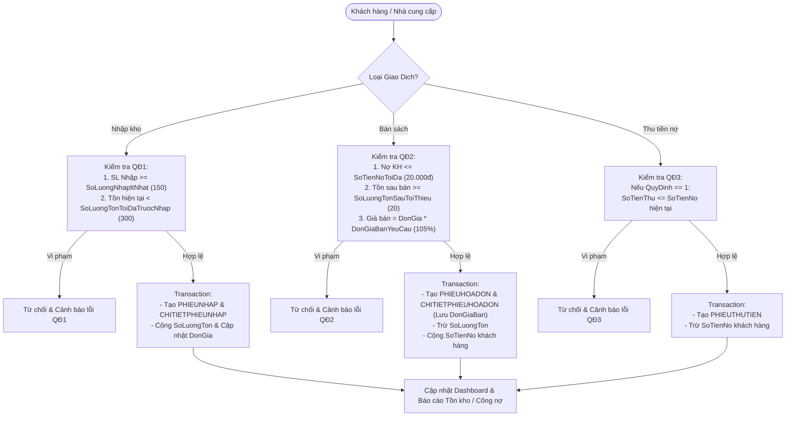

# TÀI LIỆU ĐẶC TẢ YÊU CẦU SẢN PHẨM (PRD - Product Requirements Document)
**Tên Dự Án:** Hệ Thống Quản Lý Nhà Sách (QuanLyNhaSach)  
**Phiên bản:** 2.0 (Bản cải tiến Kiến trúc & Bảo mật theo quy trình AI-Driven SDLC)  
**Vai trò thực hiện:** Senior Product Manager & Senior Business Analyst / Edge-Case Finder  

---

## 1. Tổng Quan Dự Án (Executive Summary)
Hệ thống **Quản Lý Nhà Sách** là ứng dụng web theo kiến trúc Single Page Application (SPA) kết hợp RESTful API, giúp tự động hóa quy trình quản lý kho sách, lập phiếu nhập sách, lập hóa đơn bán hàng, theo dõi công nợ khách hàng, lập phiếu thu tiền và kết xuất báo cáo thống kê định kỳ (Tồn kho & Công nợ) tuân thủ nghiêm ngặt 4 Quy định nghiệp vụ cốt lõi (QĐ1 - QĐ4).

---

## 2. Phân Rã Yêu Cầu: Epics, Features & User Stories

| Mã Epic | Tên Epic | Features (Tính năng thành phần) | Đối tượng sử dụng |
| :--- | :--- | :--- | :--- |
| **EPIC-01** | Quản lý Danh mục & Kho sách | 1.1 CRUD Sách & Tìm kiếm đa tiêu chí<br>1.2 Lập Phiếu Nhập Sách theo QĐ1 | Admin, Nhân viên |
| **EPIC-02** | Giao dịch Bán hàng & Công nợ | 2.1 Quản lý hồ sơ Khách hàng<br>2.2 Lập Hóa đơn bán sách theo QĐ2<br>2.3 Lập Phiếu thu tiền nợ theo QĐ3 | Admin, Nhân viên |
| **EPIC-03** | Báo cáo & Thống kê | 3.1 Dashboard thống kê thời gian thực<br>3.2 Báo cáo Tồn kho theo tháng/năm<br>3.3 Báo cáo Công nợ theo tháng/năm & Xuất CSV | Admin, Nhân viên |
| **EPIC-04** | Quản trị Hệ thống & Bảo mật | 4.1 Xác thực người dùng (Session Auth)<br>4.2 Phân quyền Quản lý Nhân viên (RBAC)<br>4.3 Cấu hình tham số động theo QĐ4 | Admin |

---

## 3. Đặc Tả Quy Định Nghiệp Vụ Cốt Lõi (Business Rules)

1. **QĐ1 - Quy định Nhập sách:**
   - Số lượng nhập tối thiểu mỗi lần (`SoLuongNhapItNhat`): Mặc định $\ge 150$ cuốn.
   - Chỉ nhập các đầu sách có lượng tồn kho hiện tại trước khi nhập (`SoLuongTonToiDaTruocNhap`) $< 300$ cuốn.
2. **QĐ2 - Quy định Bán sách:**
   - Chỉ bán cho khách hàng có số tiền nợ hiện tại (`SoTienNo`) $\le$ Định mức nợ tối đa (`SoTienNoToiDa`, mặc định $20.000\text{đ}$).
   - Lượng tồn kho của sách sau khi bán (`SoLuongTon - SoLuongBan`) phải $\ge$ Mức tồn tối thiểu sau bán (`SoLuongTonSauToiThieu`, mặc định $20$ cuốn).
   - Đơn giá bán được tính tự động: $\text{Đơn giá bán} = \text{Đơn giá nhập} \times \text{Tỷ lệ giá bán}$ (`DonGiaBanYeuCau`, mặc định $105\% = 1.05$).
3. **QĐ3 - Quy định Thu tiền:**
   - Khi áp dụng quy định (`QuyDinh = 1`), số tiền thu (`SoTienThu`) không được vượt quá số tiền khách hàng đang nợ (`SoTienNo`).
4. **QĐ4 - Thay đổi quy định:**
   - Quản trị viên (`Admin`) có thể thay đổi động toàn bộ các tham số của QĐ1, QĐ2, QĐ3 thông qua giao diện Cấu hình mà không cần can thiệp mã nguồn.

---

## 4. Kịch Bản User Stories Chuẩn Gherkin (Given - When - Then)

### US-01: Lập Phiếu Nhập Sách (Tuân thủ QĐ1)
```gherkin
Feature: Nhập sách vào kho (QĐ1)
  As a Nhân viên kho
  I want to lập phiếu nhập sách mới vào hệ thống
  So that lượng tồn kho và đơn giá nhập được cập nhật chính xác theo quy định QĐ1

  Scenario: Nhập sách hợp lệ (Happy Path)
    Given Tham số hệ thống có "SoLuongNhapItNhat" = 150 và "SoLuongTonToiDaTruocNhap" = 300
    And Sách "S001" đang có "SoLuongTon" = 120 và "DonGia" = 85000
    When Nhân viên gửi yêu cầu nhập sách "S001" với "SoLuong" = 150 và "DonGia" = 90000
    Then Hệ thống tạo mới bản ghi PHIEUNHAP và CHITIETPHIEUNHAP trong Transaction
    And "SoLuongTon" của sách "S001" tăng lên 270 cuốn
    And "DonGia" của sách "S001" cập nhật thành 90000
    And Trả về mã HTTP 200 kèm thông báo "Lập phiếu nhập thành công"

  Scenario: Từ chối nhập do số lượng nhập nhỏ hơn tối thiểu (Edge Case Biên Dưới)
    Given Tham số hệ thống có "SoLuongNhapItNhat" = 150
    And Sách "S001" đang có "SoLuongTon" = 120
    When Nhân viên gửi yêu cầu nhập sách "S001" với "SoLuong" = 149
    Then Hệ thống từ chối giao dịch với mã HTTP 400
    And Hiển thị thông báo lỗi "Số lượng nhập (149) phải lớn hơn hoặc bằng 150 cuốn theo quy định."

  Scenario: Từ chối nhập do lượng tồn kho hiện tại chạm hoặc vượt ngưỡng (Edge Case Biên Trên)
    Given Tham số hệ thống có "SoLuongTonToiDaTruocNhap" = 300
    And Sách "S005" đang có "SoLuongTon" = 300
    When Nhân viên gửi yêu cầu nhập sách "S005" với "SoLuong" = 150
    Then Hệ thống từ chối giao dịch với mã HTTP 400
    And Hiển thị thông báo lỗi "Chỉ nhập sách có lượng tồn nhỏ hơn 300 cuốn. Hiện tồn: 300 cuốn."
```

### US-02: Lập Hóa Đơn Bán Sách (Tuân thủ QĐ2)
```gherkin
Feature: Lập hóa đơn bán sách (QĐ2)
  As a Nhân viên bán hàng
  I want to lập hóa đơn bán sách cho khách hàng
  So that hệ thống tự động tính tiền theo tỷ lệ, trừ kho và ghi nhận công nợ chính xác

  Scenario: Bán sách hợp lệ và lưu vết lịch sử đơn giá bán
    Given Tham số có "SoTienNoToiDa" = 20000, "SoLuongTonSauToiThieu" = 20, "DonGiaBanYeuCau" = 1.05
    And Khách hàng "KH002" đang có "SoTienNo" = 15000
    And Sách "S001" đang có "SoLuongTon" = 120 và "DonGia" = 85000
    When Nhân viên lập hóa đơn cho "KH002" mua sách "S001" với "SoLuong" = 2
    Then Hệ thống tính "DonGiaBan" = 85000 * 1.05 = 89250 và "TongTien" = 178500
    And Lưu "DonGiaBan" = 89250 vào bảng CHITIETPHIEUHOADON
    And Cập nhật "SoLuongTon" của "S001" giảm còn 118 cuốn
    And Cập nhật "SoTienNo" của "KH002" tăng lên 193500

  Scenario: Từ chối bán do khách hàng nợ vượt định mức (Edge Case Công Nợ)
    Given Tham số hệ thống có "SoTienNoToiDa" = 20000
    And Khách hàng "KH004" đang có "SoTienNo" = 20001
    When Nhân viên lập hóa đơn cho "KH004" mua sách "S001" với "SoLuong" = 1
    Then Hệ thống từ chối giao dịch với mã HTTP 400
    And Hiển thị lỗi vượt định mức nợ 20,000đ

  Scenario: Từ chối bán do tồn kho sau bán nhỏ hơn mức tối thiểu (Edge Case Tồn Kho)
    Given Tham số hệ thống có "SoLuongTonSauToiThieu" = 20
    And Sách "S006" đang có "SoLuongTon" = 80
    When Nhân viên lập hóa đơn mua sách "S006" với "SoLuong" = 61
    Then Hệ thống tính tồn sau bán = 80 - 61 = 19 (< 20)
    And Hệ thống từ chối giao dịch với mã HTTP 400
```

### US-03: Lập Phiếu Thu Tiền Nợ (Tuân thủ QĐ3)
```gherkin
Feature: Lập phiếu thu tiền công nợ (QĐ3)
  As a Nhân viên thu ngân
  I want to lập phiếu thu tiền từ khách hàng đang nợ
  So that công nợ của khách hàng được khấu trừ tức thì và không thu lố tiền nợ

  Scenario: Thu một phần hoặc toàn bộ tiền nợ hợp lệ
    Given Tham số có "QuyDinh" = 1
    And Khách hàng "KH004" đang có "SoTienNo" = 18000
    When Nhân viên lập phiếu thu cho "KH004" với "SoTienThu" = 18000
    Then Hệ thống tạo bản ghi PHIEUTHUTIEN và giảm "SoTienNo" của "KH004" về 0

  Scenario: Từ chối thu khi số tiền thu vượt quá số nợ hiện tại (Edge Case Vượt Nợ)
    Given Tham số có "QuyDinh" = 1
    And Khách hàng "KH004" đang có "SoTienNo" = 18000
    When Nhân viên lập phiếu thu cho "KH004" với "SoTienThu" = 18001
    Then Hệ thống từ chối giao dịch với mã HTTP 400
```

### US-04: Phân Quyền & Thay Đổi Quy Định (Tuân thủ QĐ4 & Bảo Mật)
```gherkin
Feature: Quản trị nhân viên và cấu hình quy định (QĐ4)
  As a Quản trị viên (Admin)
  I want to thay đổi các quy định tham số và quản lý tài khoản nhân viên
  So that chỉ Admin mới được phép điều chỉnh cấu hình trọng yếu của nhà sách

  Scenario: Nhân viên thường cố tình gọi API cập nhật cấu hình hoặc xóa nhân viên (Security Edge Case)
    Given Người dùng đăng nhập với tài khoản "nhanvien" có Role = "User"
    When Người dùng gửi request PUT tới "/api/cauhinh.php" hoặc POST tới "/api/nhanvien.php"
    Then Middleware "require_admin()" chặn yêu cầu và trả về mã HTTP 403 Forbidden
```

---

## 5. Phân Tích Phản Biện & Các Trường Hợp Biên (BA Edge-Case & Risk Matrix)

Dưới góc độ **Senior BA & Edge-Case Finder**, quá trình rà soát mã nguồn hiện tại (`v1.0`) đã phát hiện **7 rủi ro nghiêm trọng về Nghiệp vụ, Bảo mật và Hiệu năng** cần được khắc phục trong bản `v2.0`:

| Mã Rủi Ro | Phân Loại | Hiện Trạng (v1.0) | Hậu Quả (Impact) | Giải Pháp Cải Tiến (v2.0) |
| :--- | :--- | :--- | :--- | :--- |
| **RISK-01** | **Nghiệp vụ (Sai lệch lịch sử giá)** | Bảng `CHITIETPHIEUHOADON` chỉ lưu `SoLuongBan`, không lưu `DonGiaBan`. Khi lập báo cáo công nợ (`api/baocao.php`), hệ thống lấy `SACH.DonGia` hiện tại $\times$ `THAMSO.DonGiaBanYeuCau` hiện tại. | Nếu sách nhập đợt mới đổi giá hoặc Admin đổi tỷ lệ giá bán, toàn bộ báo cáo công nợ của các tháng trước bị tính sai lệch hoàn toàn! | Bổ sung cột `DonGiaBan` vào `CHITIETPHIEUHOADON` để đóng băng đơn giá tại thời điểm bán; cập nhật câu truy vấn báo cáo. |
| **RISK-02** | **Bảo mật (Lộ mật khẩu Plaintext)** | File `api/auth.php` dòng 28 ghi toàn bộ raw JSON (`username`, `password`) vào file `api/debug_login.txt` có thể truy cập công khai qua HTTP. | Tin tặc có thể mở `http://localhost/Quanlymuontrasach/api/debug_login.txt` để lấy toàn bộ mật khẩu người dùng. | Xóa bỏ hoàn toàn việc ghi log nhạy cảm và xóa file `debug_login.txt`. |
| **RISK-03** | **Bảo mật (Broken Access Control)** | File `api/nhanvien.php` và `api/cauhinh.php` chỉ gọi `require_auth()` mà không gọi `require_admin()` đối với các thao tác thêm/sửa/xóa nhân viên và sửa quy định. | Nhân viên bán hàng (`Role = User`) có thể tự nâng quyền mình lên `Admin`, xóa tài khoản khác hoặc tự ý sửa quy định QĐ4. | Áp dụng `require_admin()` bắt buộc cho toàn bộ endpoint quản lý nhân viên và `PUT /api/cauhinh.php`. |
| **RISK-04** | **Bảo mật (Weak Hashing MD5)** | Mật khẩu lưu trữ bằng hàm băm `md5()` đã lỗi thời, dễ bị tấn công bảng cầu vồng (Rainbow Table). | Rủi ro lộ mật khẩu khi CSDL bị rò rỉ. | Hỗ trợ `password_hash()` (Bcrypt) kết hợp cơ chế tự động nâng cấp (transparent migration) từ MD5 sang Bcrypt khi đăng nhập. |
| **RISK-05** | **Toàn vẹn dữ liệu (Race Condition)** | Khi 2 nhân viên cùng bán 1 cuốn sách hoặc cùng thu tiền 1 khách hàng đồng thời, lệnh `SELECT` kiểm tra tồn kho/công nợ không khóa dòng (`FOR UPDATE`). | Có thể dẫn đến bán âm kho hoặc thu tiền vượt nợ khi có 2 request song song. | Đưa bước kiểm tra vào trong Transaction và sử dụng `SELECT ... FOR UPDATE` trong Repository/Service. |
| **RISK-06** | **Toàn vẹn dữ liệu (Orphan Records)** | Khi xóa Sách (`api/sach.php`) chỉ kiểm tra bảng `CHITIETPHIEUHOADON` mà quên kiểm tra `CHITIETPHIEUNHAP`; xóa Khách hàng (`api/khachhang.php`) quên kiểm tra `PHIEUTHUTIEN`. | Gây lỗi Foreign Key Constraint 500 Internal Server Error thay vì trả về thông báo nghiệp vụ rõ ràng (HTTP 400). | Kiểm tra đầy đủ cả phiếu nhập và phiếu thu trước khi xóa trong tầng Service. |
| **RISK-07** | **Nghiệp vụ (Thiếu cấu hình QĐ3 & Tỷ lệ giá)** | Giao diện và API `cauhinh.php` chưa cho phép Admin chỉnh sửa `DonGiaBanYeuCau` (tỷ lệ giá bán) và bật/tắt `QuyDinh` (QĐ3). | Chưa đáp ứng trọn vẹn QĐ4 (cho phép thay đổi toàn bộ quy định). | Mở khóa chỉnh sửa `DonGiaBanYeuCau` và công tắc bật/tắt `QuyDinh` trên cả Frontend và Backend. |

---

## 6. Sơ Đồ Luồng Nghiệp Vụ Tổng Thể (Business Process Flow)



